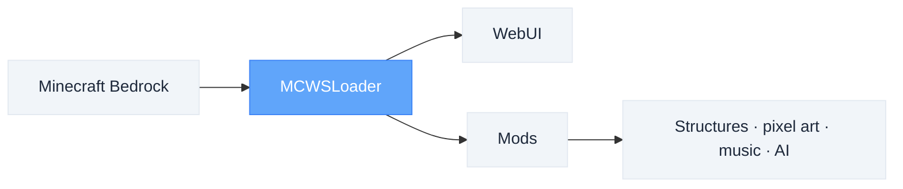

<div align="center">

# StarAwA117

*Passionate about exploration and discovery, embracing open source and ecosystem.*

`Minecraft Bedrock tooling` · `WebSocket` · `TypeScript` · `open source`

[](https://github.com/StarAwA117/MCWSLoader)
[](https://github.com/StarAwA117/MCWSLoader)
[](https://github.com/StarAwA117)
[](https://starawa117.github.io/)

</div>

```text
$ whoami
StarAwA117

$ cat focus.txt
Minecraft Bedrock / protocol bridges / developer tools / good interfaces

$ ls projects/
MCWSLoader    Litematic-Importer-WS    AntiMCBot    StarAwA117.github.io
```

---

## Currently building

### [`MCWSLoader`](https://github.com/StarAwA117/MCWSLoader)

A WebSocket bridge, WebUI and Mod loader for Minecraft Bedrock Edition.
It turns a vanilla Bedrock client into a programmable endpoint for structure tools, pixel art, music, AI commands and hot-reloadable TypeScript Mods.

[Repository](https://github.com/StarAwA117/MCWSLoader) · [Project page](https://starawa117.github.io/mcwsloader.html) · [Wiki](https://github.com/StarAwA117/MCWSLoader/wiki)

---

## Selected projects

| | Project | What it does | Stack |
|:--:|---|---|---|
| `01` | [`MCWSLoader`](https://github.com/StarAwA117/MCWSLoader) | WebSocket bridge, WebUI and TypeScript Mod loader for MCBE | `TypeScript` · `Vue 3` · `WebSocket` |
| `02` | [`Litematic Importer`](https://github.com/StarAwA117/Litematic-Importer-WS-For-MCBE) | Import `.litematic` structures into any Bedrock world over WebSocket | `JavaScript` · `MCBE` |
| `03` | [`AntiMCBot`](https://github.com/StarAwA117/AntiMCBot) | Anti-bot add-on built with the Bedrock Script API | `TypeScript` · `Script API` |
| `04` | [`StarAwA117.github.io`](https://github.com/StarAwA117/StarAwA117.github.io) | Personal site and project pages | `HTML` · `CSS` |

---

## How I build



Small core, open edges, useful defaults.

<details>
<summary><b>Toolbox</b></summary>

<br/>

**Languages** — TypeScript · JavaScript · Python · C++ · Go · Lua

**Comfortable with** — Node.js · WebSocket protocols · Vue 3 · CLI tooling · protocol debugging

**Currently exploring** — developer experience for game tooling, typed Mod APIs and local-first dashboards

</details>

---

## Elsewhere

| | |
|---|---|
| **GitHub** | [github.com/StarAwA117](https://github.com/StarAwA117) |
| **Website** | [starawa117.github.io](https://starawa117.github.io/) |
| **Discord** | [discord.gg/aAGUV2XW](https://discord.gg/aAGUV2XW) |
| **Email** | [starawa10001@outlook.com](mailto:starawa10001@outlook.com) |
